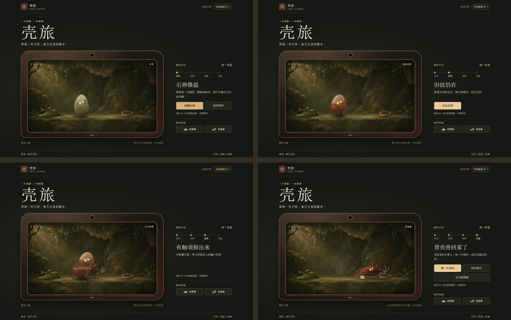

# 壳旅 · Shell Journey

一枚住着微型异兽的随身漆器。陪石卵变壳、破壳，看看它在苔石小室迈出第一步。

[打开网页试玩](https://mytmyttianqi.github.io/shell-journey/) · [下载可编辑源码](shell-journey-source.zip) · [观看两只标杆的动作实录](motion-demo.webm)

## 美术验收

[下载完整验收包](art-review.zip)

- [原创概念板](concept-board.png)
- [实屏尺寸的两只标杆剪影](silhouettes.png)
- [同一骨架与配色的两个生成个体](same-rig-variants.png)
- [探路归来后的铜灯与装备](room-after-expedition.png)

页面默认在浏览器运行本地造型 AI。可切换规则模拟，或接入联网模型。源码包含训练样本、模型权重、参数校验和两只标杆的透明图层。
